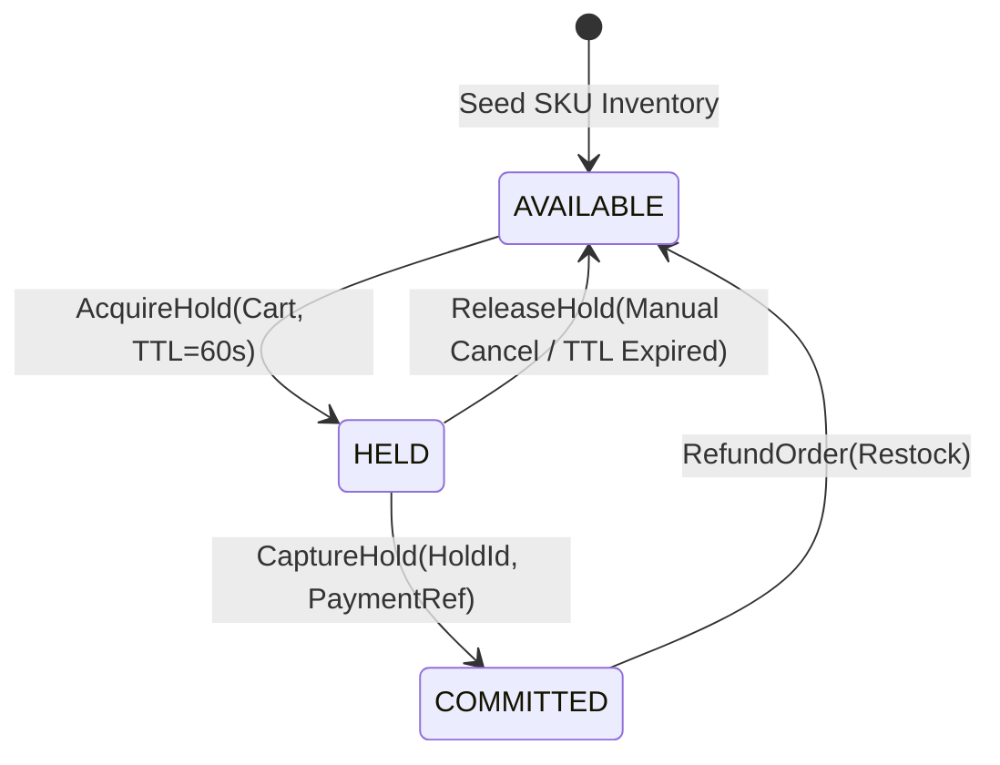
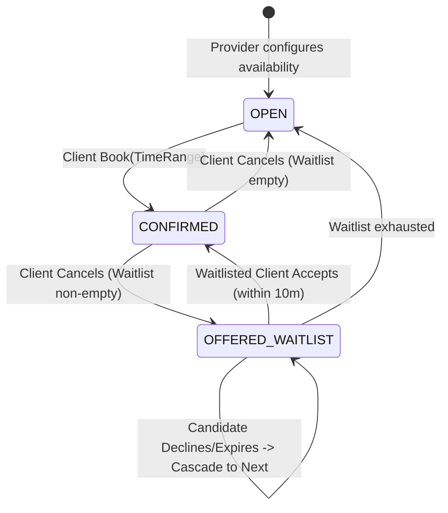
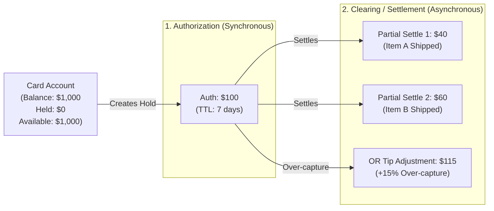
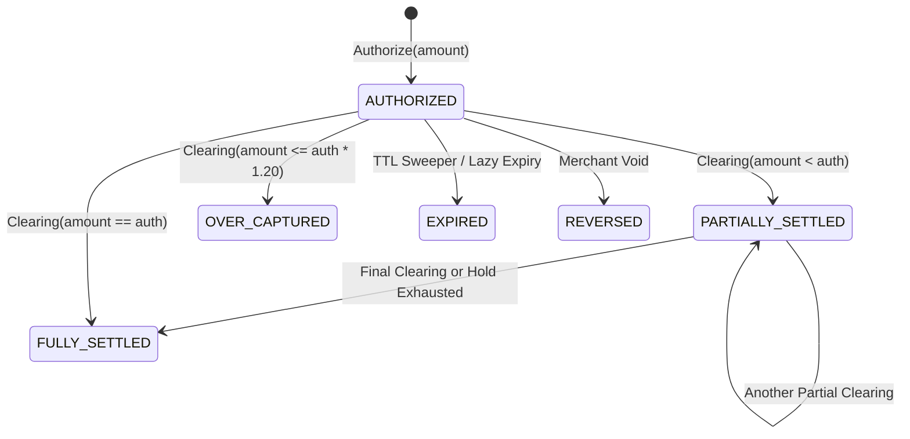
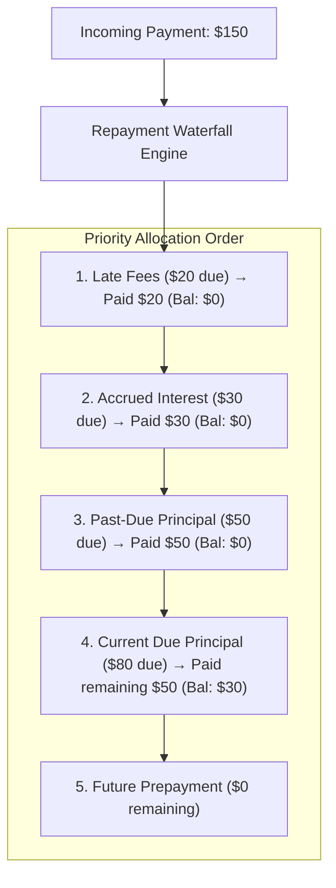
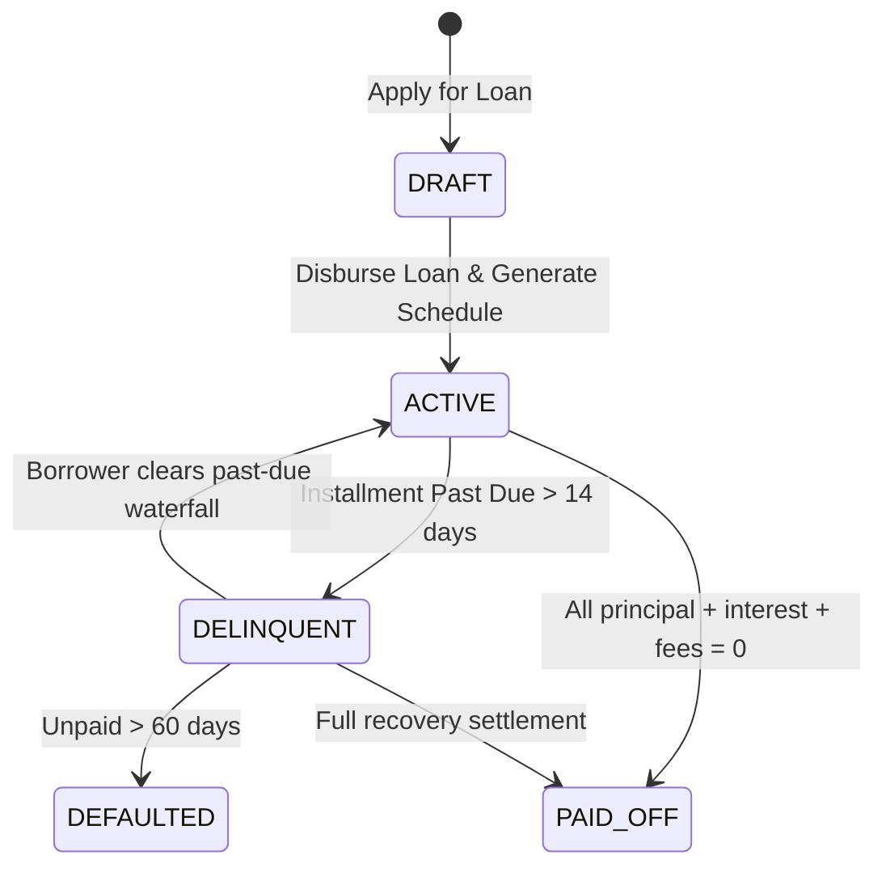

# Staff Engineer LLD Practice Problems

This document contains four Staff-level Low-Level Design (LLD) problems designed to practice domain modeling and concurrency paradigms distinct from simple consumer ledgers.

- **Part 1: Cross-Domain Paradigms** (Inventory Leases, Temporal Intervals)
- **Part 2: Specialized FinTech Paradigms** (Dual-Message Card Processing, Debt Waterfalls)

All problems are formatted according to the standard **90-minute Staff LLD coding interview**:
- **Requirements (~10 min)**: Problem clarification, business rule trade-offs, and boundary definitions.
- **Design (~15 min)**: Domain modeling, state machines, API surface, and data models.
- **Build (~45 min)**: In-memory core flow implementation, thread safety, and testability.
- **Edge Cases (~15 min)**: High contention, race conditions, retries, and failure recoveries.
- **Review (~5 min)**: Code critique, production readiness, and architectural trade-offs.

---

## Domain Modeling Comparison Matrix

| Problem | Core Domain Paradigm | Concurrency & Contention Challenge | Architectural Highlight |
| :--- | :--- | :--- | :--- |
| **Multi-Currency Wallet** *(Reference)* | Double-entry balance ledger & FX exchange rates | Double-spend on quotes, racing transfers | Settlement pools, 5-leg balance movements, LIFO Saga compensation |
| **1. Flash Sale Inventory Engine** | Discrete quota allocation & hold leases | Deadlocks on multi-item carts, thundering herd on drop | Two-phase reservation (Hold &rarr; Commit), lexicographical lock hierarchy |
| **2. Interval Booking & Waitlist Engine** | Temporal continuous intervals & priority queues | Double-booking overlaps, offer expiry races, queue starvation | Interval collision algebra, stateful cascading timers, anti-sniping gates |
| **3. Card Auth & Clearing Engine** | Dual-message card processing (Holds vs. Settlements) | Multi-clearing race on single auth, over-capture, force-posts | Two-tier balance model, rolling velocity window, tolerance rules |
| **4. BNPL Amortization & Waterfall** | Debt amortization & priority allocation waterfalls | Autopay vs. manual repayment race, late-fee race | Ordered debt waterfall, dynamic schedule recalculation, delinquency state |

---

# Part 1: Cross-Domain Paradigms

---

# Problem 1: High-Contention Flash Sale & Inventory Lease Engine

## 1. The Interview Brief
> *"We are launching a limited-edition sneaker/ticket flash drop. We have a set of products (SKUs), each with finite inventory (e.g., 100 units). Buyers can place a cart holding up to 3 different items. When a buyer checks out, items are placed on **HOLD for 60 seconds**. If the buyer submits payment within 60 seconds, the order is confirmed and inventory is permanently decremented. If the hold expires or the buyer cancels, the held inventory must immediately return to the available pool. We also need to handle refunds/restocking. Everything runs in-memory. Walk us through your requirements, domain model, API, concurrency controls, and failure recovery."*

## 2. Why the Domain Modeling is Different
1. **Discrete Quotas vs. Continuous Ledgers**: Inventory cannot be treated as a fluid account balance. Stock transitions across strict lifecycle states: `AVAILABLE` &rarr; `HELD` &rarr; `COMMITTED` &rarr; `RESTOCKED`.
2. **Two-Phase Reservation Pattern (Hold &rarr; Capture / Release)**: Borrowed from airline seat allocation and hotel booking engines. The system issues a time-bound `HoldToken` or `Lease` that invalidates automatically.
3. **Multi-Resource Lock Ordering (Deadlock Risk)**: If Buyer A reserves `[SKU_1, SKU_2]` while Buyer B concurrently reserves `[SKU_2, SKU_1]`, naive locking causes circular wait deadlocks.
4. **Lazy vs. Active Expiration**: Expired holds must either be cleaned up by a background sweeper or evaluated lazily at allocation time without blocking active transactions.

## 3. Requirements & Ambiguities to Lead With (~10 min)
- **Partial Allocation Policy**: If a user requests 2 units of SKU_A and 1 unit of SKU_B, but SKU_B is out of stock, do we hold SKU_A or reject the cart entirely? *(Decision: All-or-nothing atomic reservation).*
- **Late Payment Race (Second 60.5)**: What happens if a payment confirmation arrives right as the hold expires and stock was reassigned? Does the checkout fail with an auto-refund, or is there an internal grace period?
- **Per-User Hold Limits**: Can a single user hold multiple carts concurrently to hoard inventory?
- **Over-selling vs. Under-utilization**: In flash sales, preventing overselling ($Stock < 0$) is a hard invariant, but hoarding prevention is equally critical.

## 4. Domain Model & State Machine (~15 min)



### Core In-Memory Entities
```python
@dataclass
class ProductStock:
    sku_id: str
    total_stock: int
    available_stock: int
    held_stock: int
    committed_stock: int
    lock: threading.RLock = field(default_factory=threading.RLock)
    # Invariant: total_stock == available_stock + held_stock + committed_stock

@dataclass
class HoldItem:
    sku_id: str
    quantity: int

@dataclass
class HoldLease:
    hold_id: str
    user_id: str
    items: List[HoldItem]
    expires_at: datetime
    status: str  # PENDING | CAPTURED | EXPIRED | RELEASED
    lock: threading.RLock = field(default_factory=threading.RLock)

@dataclass
class OrderRecord:
    order_id: str
    hold_id: str
    user_id: str
    payment_reference: str
    status: str  # CONFIRMED | REFUNDED
    idempotency_key: Optional[str]
```

## 5. API Surface
- `POST /holds`: Request an inventory hold for up to 60 seconds.
  - Body: `{"user_id": "usr_1", "items": [{"sku_id": "SKU_A", "quantity": 2}]}`
  - Response: `201 Created` with `hold_id`, `expires_at`, `status: PENDING`.
- `POST /orders/checkout`: Commit a held reservation upon payment.
  - Headers: `Idempotency-Key`
  - Body: `{"hold_id": "hld_123", "payment_reference": "pay_xyz"}`
  - Response: `200 OK` with `order_id`, `status: CONFIRMED` | `409 Conflict` (Hold expired/invalid).
- `POST /holds/{hold_id}/release`: Explicit cart cancellation before expiration.
- `GET /products/{sku_id}/availability`: Inspect inventory breakdown (`available`, `held`, `committed`).

## 6. Critical Concurrency & Edge Cases (~15 min)
1. **Deadlock-Free Multi-SKU Locking**:
   Sort requested items lexicographically by `sku_id` before acquiring per-SKU locks:
   ```python
   sorted_skus = sorted(request.items, key=lambda x: x.sku_id)
   # Acquire locks in sorted order
   ```
2. **Hold Expiry vs. Payment Capture Collision**:
   The hold check and state transition (`PENDING` &rarr; `CAPTURED`) must occur under `hold.lock`. If expired, reject checkout, do not decrement inventory, and flag payment for refund.
3. **Thundering Herd Stock Restoration**:
   When holds expire, inventory counters must be safely restored to `available_stock` without race conditions or negative numbers.

---

# Problem 2: Time-Window Resource Booking & Waitlist Engine

## 1. The Interview Brief
> *"We're building an in-memory scheduling platform for specialized consultants/doctors. Each provider has defined operating hours and appointment slots (e.g., 30 or 60 minutes) with a mandatory 15-minute buffer/clean-up window between meetings. Clients can book available slots. If a slot is booked, other clients can join a **Waitlist** for that slot. If the original booking is cancelled, the slot is not made public immediately—it is **offered to the #1 person on the waitlist for a 10-minute acceptance window**. If they accept, they get the slot; if they decline or let the 10 minutes lapse, it cascades to the next person or returns to public availability. Walk us through your design, interval collision detection, and concurrency control."*

## 2. Why the Domain Modeling is Different
1. **Continuous Temporal Intervals vs. Discrete Counters**: Validations require interval algebra:
   $$\text{Collision if } \max(\text{start}_1, \text{start}_2) < \min(\text{end}_1 + \text{buffer}, \text{end}_2 + \text{buffer})$$
2. **Cascading State Machine with Timers**: Booking cancellations do not merely free up state; they trigger a multi-stage workflow across a priority queue of waitlisted candidates.
3. **Anti-Sniping Guards**: While an offer is pending for a waitlisted candidate, external users hitting the booking endpoint must be blocked from sniping the slot.

## 3. Requirements & Ambiguities to Lead With (~10 min)
- **Buffer Scope**: Does the 15-minute buffer apply between different clients, or also between slots for the same client? Does it count as booked time?
- **Waitlist Priority**: FIFO ordering vs. client tier/VIP weighting?
- **Offer Timeout Behavior**: If the top candidate fails to respond within 10 minutes, do they drop off the waitlist or move to the bottom?
- **Timezone Normalization**: How are operating hours and slot requests normalized? *(Decision: Store all timestamps in UTC with ISO 8601 formatting).*

## 4. Domain Model & State Machine (~15 min)



### Core In-Memory Entities
```python
@dataclass
class TimeRange:
    start_time: datetime
    end_time: datetime

    def overlaps_with(self, other: "TimeRange", buffer_minutes: int = 15) -> bool:
        buffered_end_self = self.end_time + timedelta(minutes=buffer_minutes)
        buffered_end_other = other.end_time + timedelta(minutes=buffer_minutes)
        return max(self.start_time, other.start_time) < min(buffered_end_self, buffered_end_other)

@dataclass
class Booking:
    booking_id: str
    provider_id: str
    client_id: str
    time_range: TimeRange
    status: str  # CONFIRMED | CANCELLED | COMPLETED
    created_at: datetime

@dataclass
class WaitlistOffer:
    offer_id: str
    client_id: str
    offered_at: datetime
    expires_at: datetime
    status: str  # PENDING | ACCEPTED | DECLINED | EXPIRED

@dataclass
class WaitlistQueue:
    provider_id: str
    slot_start: datetime
    candidates: List[str]  # FIFO client IDs
    current_offer: Optional[WaitlistOffer] = None
    lock: threading.RLock = field(default_factory=threading.RLock)
```

## 5. API Surface
- `GET /providers/{id}/available-slots?date=YYYY-MM-DD`: Computes unbooked slots that obey operating hours and 15-minute buffers.
- `POST /bookings`: Book an available slot.
  - Headers: `Idempotency-Key`
  - Body: `{"provider_id": "p1", "client_id": "c1", "start_time": "...", "end_time": "..."}`
  - Response: `201 Created` | `409 Conflict` (Interval collision).
- `POST /bookings/{id}/cancel`: Cancel booking and automatically trigger waitlist offer cascade.
- `POST /waitlist`: Join waitlist for a specific provider and time window.
- `POST /waitlist/offers/{offer_id}/accept`: Accept a pending waitlist offer within the 10-minute window.
  - Headers: `Idempotency-Key`

## 6. Critical Concurrency & Edge Cases (~15 min)
1. **Interval Overlap Race**:
   Two requests for overlapping windows (`10:00-10:30` and `10:15-10:45`) arrive at the exact same millisecond. Locking the provider's calendar ensures only one passes collision detection.
2. **The "Zombie Offer" Race**:
   Candidate #1 submits `/accept` at second 601 (1 second late), while the cascade worker is transitioning the offer to `EXPIRED` and notifying Candidate #2. The offer lock must guarantee only one state transition succeeds.
3. **Cancellation vs. Waitlist Join Race**:
   A user joins the waitlist at the exact moment the active booking is cancelled. Synchronization between the booking record and the waitlist queue ensures the new candidate is neither lost nor skipped.

---

# Part 2: Advanced FinTech Paradigms

---

# Problem 3: Dual-Message Payment Card Authorization & Clearing Engine

## 1. The Interview Brief
> *"You are building the core in-memory transaction processor for a card issuing platform (like Stripe Issuing / Marqeta). Each cardholder has an account with a credit/debit limit and real-time velocity rules (e.g. max $500 per single transaction, max 5 transactions per rolling 24-hour window). When a merchant swipes a card, your service receives an **Authorization** request. If approved, funds are placed on a **temporary Auth Hold (TTL: 7 days)** without moving settled funds. Later, the merchant sends a **Clearing** request. The clearing amount can be:
> 1. Exact match (standard retail checkout).
> 2. Higher than auth within a tolerance (e.g. +20% for restaurant tips).
> 3. Lower than auth (e.g. item out of stock).
> 4. Multiple partial clearings against a single auth (e.g. items shipped separately).
> If a clearing request doesn't arrive within 7 days, the hold expires and funds are released. Everything runs in-memory. Walk us through your domain model, velocity engine, state machine, and concurrency controls."*

## 2. Why the Domain Modeling is Different



1. **Dual Balance Representation**:
   - `Settled Balance`: Actual cleared money/debt.
   - `Auth Holds`: Temporary reserved balances.
   - $\text{Available Balance} = \text{Credit Limit} - \text{Settled Balance} - \sum \text{Active Auth Holds}$.
2. **One-to-Many Clearing Relationships**: An authorization is not a 1:1 transaction. One `Auth` can produce $0 \dots N$ partial `Clearing` events until the hold is exhausted or explicitly released.
3. **Sliding-Window Velocity Tracking**: Validating spend velocity (e.g., "no more than \$1,000 in rolling 60 minutes") requires in-memory sliding window timestamps per cardholder.
4. **Over-Capture & Force-Post Policies**: What happens when a merchant captures \$120 on a \$100 auth? What if a clearing request arrives with *no* prior auth (known in banking as a **Force-Post**)?

## 3. Requirements & Ambiguities to Lead With (~10 min)
- **Over-Capture Tolerance Threshold**: Is there a maximum percentage or fixed amount allowable above the authorized hold (e.g. +20% for hospitality/restaurants)?
- **Force-Post Handling**: How do we handle offline transactions (e.g., in-flight purchases) where a clearing arrives without any preceding authorization? *(Decision: Always approve and debit settled balance, allowing account to go over-limit with an audit flag).*
- **Partial Clearing Termination**: When a partial clearing arrives, does the merchant specify whether additional clearings will follow, or does any unused hold remain open until the 7-day TTL?
- **Cardholder Velocity Scope**: Do velocity limits evaluate authorized requests, settled transactions, or both?

## 4. Domain Model & State Machine (~15 min)



### Core In-Memory Entities
```python
@dataclass
class CardAccount:
    card_id: str
    user_id: str
    credit_limit: int         # Minor units (e.g. 100000 = $1,000.00)
    settled_balance: int      # Cleared debt
    status: str               # ACTIVE | FROZEN
    lock: threading.RLock = field(default_factory=threading.RLock)

    def available_balance(self, active_holds_sum: int) -> int:
        return self.credit_limit - self.settled_balance - active_holds_sum

@dataclass
class AuthHoldRecord:
    auth_id: str
    card_id: str
    merchant_descriptor: str
    authorized_amount: int    # Original hold amount
    remaining_hold: int       # Decremented as partial clearings arrive
    status: str               # ACTIVE | FULLY_SETTLED | EXPIRED | REVERSED
    expires_at: datetime
    created_at: datetime
    lock: threading.RLock = field(default_factory=threading.RLock)

@dataclass
class ClearingRecord:
    clearing_id: str
    auth_id: Optional[str]    # None for force-posts
    card_id: str
    settled_amount: int
    capture_type: str         # EXACT | PARTIAL | OVER_CAPTURE | FORCE_POST
    created_at: datetime

@dataclass
class VelocityEvent:
    timestamp: datetime
    amount: int
```

## 5. API Surface
- `POST /authorizations`: Fast synchronous decision path.
  - Body: `{"card_id": "c_1", "amount": 10000, "merchant": "Uber"}`.
  - Returns `201 APPROVED` with `auth_id`, or `422 DECLINED` (`INSUFFICIENT_FUNDS`, `VELOCITY_EXCEEDED`, `CARD_FROZEN`).
- `POST /authorizations/{auth_id}/reverse`: Merchant cancel/void. Releases remaining hold immediately.
- `POST /clearings`: Settlement capture.
  - Headers: `Idempotency-Key`
  - Body: `{"auth_id": "auth_1", "amount": 6000, "is_final": false}`.
- `GET /cards/{card_id}/balance`: Returns `settled_balance`, `held_balance`, and `available_balance`.

## 6. Critical Concurrency & Edge Cases (~15 min)
1. **Racing Multi-Clearing on a Single Auth**:
   A merchant submits two partial captures simultaneously (e.g., two warehouses shipping different parts of an order at the same second).
   *Failure Mode*: Both threads read `remaining_hold = $100` and each subtracts \$60, causing negative hold corruption.
   *Fix*: Acquire `auth_hold.lock`, mutate `remaining_hold`, and adjust the card's `settled_balance` atomically under the card lock.
2. **The "Force-Post" (Clearing without Prior Auth)**:
   Offline systems submit clearings with no preceding `auth_id`. The system must permit the debit even if it exceeds the card's available limit, driving the account into an over-limit state with an audit flag.
3. **Over-Capture Tip Calculation**:
   When an auth of \$50 is cleared for \$60 (within the configured +20% threshold):
   - Clear \$60 to `settled_balance`.
   - Release the full \$50 auth hold.
   - Net impact on available balance: -\$10.

---

# Problem 4: BNPL Loan Amortization & Repayment Waterfall Engine

## 1. The Interview Brief
> *"We're building an in-memory BNPL lending core. When a customer buys an item for \$1,000, we originate a **Loan with 4 equal bi-weekly installments** (Pay-in-4) or a monthly installment plan with interest. When an installment becomes past due, late fees accrue according to business rules. When a borrower makes a payment, money **CANNOT** just be subtracted from a balance. It must flow through an immutable **Repayment Waterfall**:
> 1. Unpaid Late Fees & Penalties (first)
> 2. Accrued Interest (second)
> 3. Oldest Past-Due Principal (third)
> 4. Current Due Principal (fourth)
> 5. Future Principal Prepayment (excess funds reduce future installments).
>
> Borrowers can make partial payments, exact payments, or full prepayments. If an installment is unpaid 14 days past due, the loan status transitions from `ACTIVE` to `DELINQUENT`. Walk us through your loan amortization engine, the waterfall allocation algorithm, loan lifecycle state machine, and concurrency controls."*

## 2. Why the Domain Modeling is Different



1. **Repayment Waterfalls vs. Direct Debits**: In a wallet, \$100 is just \$100. In lending, \$100 must be chopped up across multiple debt buckets in legal priority order.
2. **Stateful Schedule Mutation (Prepayment Re-amortization)**: If a borrower pays extra, how does that affect future installments? (Shorten loan term vs. lower future installment amounts).
3. **Delinquency State Transitions**: A background worker evaluates loan health: `ACTIVE` &rarr; `GRACE_PERIOD` &rarr; `DELINQUENT` &rarr; `DEFAULTED`.

## 3. Requirements & Ambiguities to Lead With (~10 min)
- **Prepayment Strategy**: Does an overpayment shorten the loan duration (deducting from the final installment backward) or reduce the monthly amount across all future installments?
- **Delinquency Grace Period**: How many days after `due_date` before a late fee is applied, and how many days before status transitions to `DELINQUENT`?
- **Overpayment Cap**: What happens if a borrower pays more than the total remaining payoff amount ($Principal + Interest + Fees$)? *(Decision: Reject overpayment or refund excess).*
- **Interest Compounding**: Simple daily interest vs. flat monthly fee?

## 4. Domain Model & State Machine (~15 min)



### Core In-Memory Entities
```python
@dataclass
class InstallmentScheduleItem:
    installment_id: str
    loan_id: str
    installment_number: int  # 1, 2, 3, 4
    due_date: datetime
    principal_due: int       # Minor units
    interest_due: int
    late_fee_due: int
    principal_paid: int = 0
    interest_paid: int = 0
    late_fee_paid: int = 0
    status: str = "PENDING"  # PENDING | PARTIALLY_PAID | PAID | LATE

    @property
    def total_outstanding(self) -> int:
        return (self.principal_due - self.principal_paid) + \
               (self.interest_due - self.interest_paid) + \
               (self.late_fee_due - self.late_fee_paid)

@dataclass
class LoanRecord:
    loan_id: str
    borrower_id: str
    principal_amount: int
    interest_rate: Decimal
    status: str              # ACTIVE | DELINQUENT | DEFAULTED | PAID_OFF
    schedule: List[InstallmentScheduleItem]
    lock: threading.RLock = field(default_factory=threading.RLock)

@dataclass
class PaymentAllocationRecord:
    payment_id: str
    loan_id: str
    total_amount: int
    allocated_to_fees: int
    allocated_to_interest: int
    allocated_to_principal: int
    excess_prepayment: int
    created_at: datetime
```

## 5. API Surface
- `POST /loans`: Originate loan and calculate amortization schedule.
  - Body: `{"borrower_id": "b_1", "amount": 100000, "term_months": 3, "apr": "0.12"}`.
  - Response: `201 Created` with full amortization breakdown.
- `POST /loans/{loan_id}/repayments`: Submit a repayment.
  - Headers: `Idempotency-Key`
  - Body: `{"amount": 35000}`.
  - Response: `200 OK` with detailed waterfall breakdown (`fees_cleared`, `interest_cleared`, `principal_reduced`, `remaining_loan_balance`).
- `GET /loans/{loan_id}/schedule`: Inspect installment statuses, due dates, and paid components.
- `POST /loans/{loan_id}/assess-penalties`: Batch/cron trigger to evaluate grace periods and apply late fees.

## 6. Critical Concurrency & Edge Cases (~15 min)
1. **Autopay vs. Manual Payment Race**:
   At 00:00:00, an automated nightly ACH charge of \$250 executes. At 00:00:01, the customer manually submits a \$250 repayment in their app.
   *Risk*: Both threads run the waterfall calculation against the *same* unpaid installment, causing both to report the installment as "PAID" while double-crediting principal.
   *Fix*: Acquire `loan.lock`. The second payment reads the updated schedule, sees the current installment is already `PAID`, and applies the \$250 as an early prepayment to future principal.
2. **Late-Fee Assessment Race**:
   A penalty assessment worker attempts to mark an installment as `LATE` and append a \$15 fee, while a repayment is in flight clearing that exact installment. Under `loan.lock`, if the repayment clears the principal before the fee worker acquires the lock, the late fee must be aborted.
3. **Decimal Rounding in Equal Installments**:
   Dividing \$1,000 into 3 payments yields \$333.3333...
   Installments must be:
   - Installment 1: \$333.34
   - Installment 2: \$333.33
   - Installment 3: \$333.33
   *Invariant*: The sum of schedule principals must equal the loan origination principal down to the exact cent.
