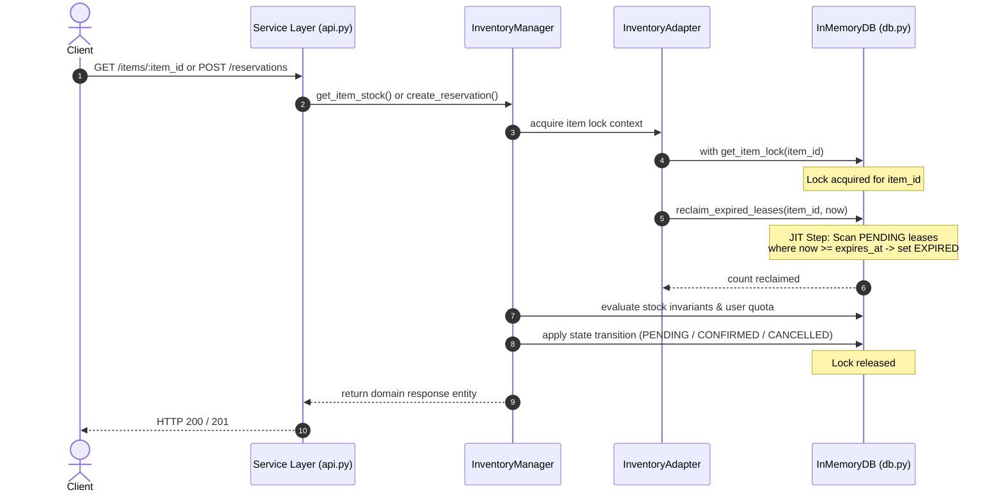

# Specification 002: Inventory Manager & Adapter Layers with JIT Reclamation and E2E Wiring

**Scope: Full Stack** (Manager Layer, Adapter Layer, In-Memory Database Engine & Service E2E Wiring)

---

## 1. Overview & Scope

### 1.1 Purpose
This specification implements the core domain logic, persistence boundary, and in-memory thread-safe database engine for the Flash Sale Inventory Reservation service. It connects the Service Layer (`app/service/api.py`) to the newly built Manager and Adapter layers, delivering an end-to-end working system with:
1. **Per-Item Fine-Grained Locking**: Strict serialized access per catalog SKU to prevent race conditions and guarantee zero overselling.
2. **Just-In-Time (JIT) Lease Reclamation**: On-demand expiration of overdue reservation leases (> 30s TTL) prior to reading stock or creating reservations.
3. **Anti-Hoarding Enforcement**: Per-user purchase quotas strictly bounded across active reservations and confirmed purchases.

---

## 2. Concurrency & JIT Reclamation Architecture

### 2.1 The Locking Model
To maintain maximum throughput under heavy flash sale traffic while guaranteeing zero overselling:
- **Lock Granularity**: Dedicated `threading.RLock()` per `item_id`.
  - Contention on `item_A` (e.g. VIP ticket) never blocks operations on `item_B` (e.g. General Admission).
- **Critical Section Scope**: The lock is held during the entire check-and-modify sequence:
  1. Acquire lock: `with db.get_item_lock(item_id):`
  2. Perform JIT reclamation of expired leases for `item_id`.
  3. Compute live stock and enforce user quotas.
  4. Perform state mutation (create, confirm, or cancel lease).
  5. Release lock.
- **Deadlock-Free Global Operations (`GET /items`)**:
  - When querying multiple items, locks are acquired sequentially item-by-item (or in deterministic lexicographical order `sorted(items.keys())`).



### 2.2 Just-In-Time (JIT) Reclamation Mechanics
Rather than relying on non-deterministic background sweeper threads or polling loops:
1. **Trigger Points**: JIT reclamation is invoked synchronously inside the item's lock before any of the following:
   - `GET /items`: Sweeps each item prior to computing stock metrics.
   - `GET /items/<item_id>`: Sweeps the item prior to returning available/held counts.
   - `POST /reservations`: Sweeps the item prior to verifying available inventory.
   - `POST /reservations/<id>/confirm`: Sweeps the item prior to validating lease expiration.
   - `POST /reservations/<id>/cancel`: Sweeps the item prior to releasing the hold.
2. **Reclamation Algorithm**:
   ```python
   def reclaim_expired_leases(item_id: str, now: float) -> int:
       reclaimed_count = 0
       for res in reservations_by_item(item_id):
           if res.status == "PENDING" and now >= res.expires_at:
               res.status = "EXPIRED"
               reclaimed_count += 1
       return reclaimed_count
   ```
3. **Inventory Invariant**:
   $$\text{Available Stock} = \text{Total Stock} - \text{Confirmed Stock} - \sum_{r \in \text{PENDING}(now < expires\_at)} r.\text{quantity}$$
   Because JIT runs *before* evaluation under `item_lock`, expired leases are purged instantly and their quota immediately becomes available to other concurrent buyers.

---

## 3. In-Memory Database Engine (`app/adapter/db.py`)

A singleton thread-safe store simulating an in-memory database:

```python
class InMemoryDB:
    def __init__(self):
        self._items: Dict[str, ItemRecordEntity] = {}
        self._reservations: Dict[str, ReservationRecordEntity] = {}
        self._item_locks: Dict[str, threading.RLock] = {}
        self._global_lock = threading.RLock()
        self._seed_data()

    def get_item_lock(self, item_id: str) -> threading.RLock:
        """Fetch or create re-entrant lock for a specific item thread-safely."""
        with self._global_lock:
            if item_id not in self._item_locks:
                self._item_locks[item_id] = threading.RLock()
            return self._item_locks[item_id]

    def reclaim_expired_leases(self, item_id: str, now: float) -> int:
        """Transition overdue PENDING reservations to EXPIRED under lock."""
        ...
```

### Seed Data
The database engine initializes with default catalog items:
- `item_vip_ticket`: `name="VIP Concert Pass"`, `total_stock=10`, `max_per_user=2`
- `item_ga_ticket`: `name="General Admission Ticket"`, `total_stock=50`, `max_per_user=4`
- `item_merch_hoodie`: `name="Limited Edition Tour Hoodie"`, `total_stock=5`, `max_per_user=1`

---

## 4. Manager &harr; Adapter Contract (`app/adapter/entities.py`)

Dataclasses defining internal persistence records:

```python
from dataclasses import dataclass
from typing import Optional

@dataclass
class ItemRecordEntity:
    """Internal database record for a catalog item."""
    item_id: str
    name: str
    total_stock: int
    max_per_user: int

@dataclass
class ReservationRecordEntity:
    """Internal database record for a reservation lease."""
    reservation_id: str
    item_id: str
    user_id: str
    quantity: int
    status: str       # "PENDING" | "CONFIRMED" | "CANCELLED" | "EXPIRED"
    created_at: float
    expires_at: float
    confirmed_at: Optional[float] = None
```

---

## 5. Adapter Layer (`app/adapter/inventory_adapter.py`)

A consolidated `InventoryAdapter` exposing clean CRUD operations and locking context managers:
- `get_item_lock(item_id: str) -> ContextManager`: Acquires the per-item lock.
- `reclaim_expired(item_id: str, now: float) -> int`: Invokes JIT lease reclamation.
- `get_item(item_id: str) -> Optional[ItemRecordEntity]`: Retrieves item record.
- `get_all_items() -> List[ItemRecordEntity]`: Retrieves all catalog items.
- `save_reservation(record: ReservationRecordEntity) -> None`: Persists a reservation.
- `get_reservation(reservation_id: str) -> Optional[ReservationRecordEntity]`: Retrieves reservation by ID.
- `get_item_reservations(item_id: str) -> List[ReservationRecordEntity]`: Returns all reservations for an item.
- `get_user_item_reservations(item_id: str, user_id: str) -> List[ReservationRecordEntity]`: Returns user's reservations for an item.

---

## 6. Manager Layer (`app/manager/`)

### 6.1 Domain Exceptions (`app/manager/exceptions.py`)
- `ItemNotFoundError` (HTTP 404): Item does not exist.
- `ReservationNotFoundError` (HTTP 404): Reservation does not exist.
- `InsufficientStockError` (HTTP 409): Available stock < requested quantity.
- `PurchaseLimitExceededError` (HTTP 409): User quota exceeded.
- `ReservationExpiredError` (HTTP 410): 30s lease window has expired.
- `ReservationStateConflictError` (HTTP 409): Reservation already confirmed or cancelled.
- `UnauthorizedReservationAccessError` (HTTP 403): User ID does not match reservation owner.

### 6.2 Consolidated Manager (`app/manager/inventory_manager.py`)
Encapsulates business rules, clock injection (`time_provider`), and response transformation:
- `get_item_stock(item_id: str) -> ItemStockResponseEntity`
- `list_items_stock() -> List[ItemStockResponseEntity]`
- `create_reservation(request: CreateReservationRequestEntity) -> ReservationResponseEntity`
- `confirm_reservation(request: ConfirmReservationRequestEntity) -> ReservationResponseEntity`
- `cancel_reservation(request: CancelReservationRequestEntity) -> ReservationResponseEntity`

---

## 7. Service Layer E2E Wiring (`app/service/api.py`)

1. **Remove `NotImplementedError`**:
   Route handlers call corresponding `inventory_manager` methods and return JSON responses with proper HTTP status codes (`200 OK`, `201 Created`).
2. **Register Domain Exception Handlers**:
   - `ItemNotFoundError`, `ReservationNotFoundError` &rarr; `404 Not Found`
   - `InsufficientStockError`, `PurchaseLimitExceededError`, `ReservationStateConflictError` &rarr; `409 Conflict`
   - `ReservationExpiredError` &rarr; `410 Gone`
   - `UnauthorizedReservationAccessError` &rarr; `403 Forbidden`

---

## 8. Test Plan (`tests/`)

1. **Unit & Layer Contract Tests**:
   - Verify JIT reclamation transitions expired leases on item lookup.
   - Verify user purchase limit prevention.
   - Verify reservation state transition validations (double confirmation, cancelling after expiry).
2. **E2E API Integration Tests**:
   - `GET /health` &rarr; `200`
   - `GET /items` &rarr; lists seeded items with stock breakdowns.
   - `POST /reservations` &rarr; `201` holds stock for 30s.
   - `POST /reservations/:id/confirm` &rarr; `200` transitions to `CONFIRMED`.
   - `POST /reservations/:id/cancel` &rarr; `200` releases hold immediately.
   - Lease expiry simulation &rarr; `410 Gone` upon late confirmation.
3. **Concurrency Test**:
   - Concurrent threads racing to reserve stock exceeding total available; assert zero overselling.
