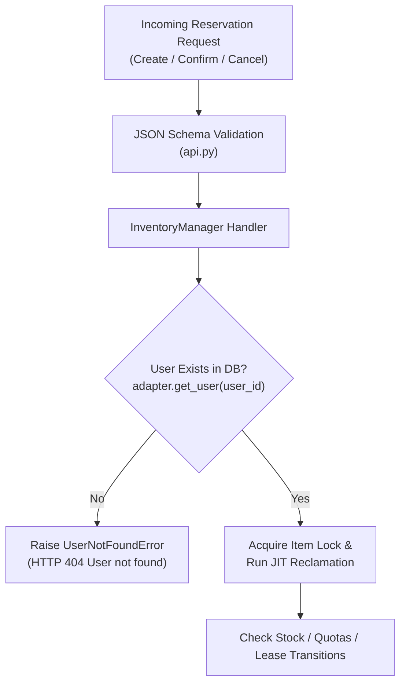

# Specification 003: User Entity Domain Model & Validation Integration

**Scope: Full Stack** (Adapter Layer &rarr; Manager Layer &rarr; Service Layer &rarr; Postman Collection &rarr; Tests)

---

## 1. Overview & Scope

### 1.1 Purpose
Currently, `user_id` is passed as an unverified string identifier in reservation operations. This specification introduces a first-class **User** domain entity pre-seeded in the database at startup and integrates user identity validation directly into the existing reservation, confirmation, and cancellation workflows.

Key requirements:
1. **Pre-Seeded Users (No Creation API)**: Users are pre-seeded at startup in `InMemoryDB` without exposing a user registration endpoint (`POST /users`).
2. **Read-Only User Visibility**: Provides `GET /users` and `GET /users/<user_id>` to inspect registered users and test with valid accounts.
3. **Strict User Validation**: `POST /reservations`, `POST /reservations/<id>/confirm`, and `POST /reservations/<id>/cancel` verify that the requesting `user_id` is a valid, pre-seeded user before proceeding; otherwise, they return `404 Not Found`.

---

## 2. Integration with Existing Code

### 2.1 Workflow Validation Integration



1. **`create_reservation`**:
   - Before acquiring the item lock or checking stock/quotas, verifies `user = self._adapter.get_user(request.user_id)`.
   - If not found: raises `UserNotFoundError(f"User '{request.user_id}' not found")` &rarr; returns `404 Not Found`.
2. **`confirm_reservation`**:
   - Verifies `user = self._adapter.get_user(request.user_id)`.
   - If not found: raises `UserNotFoundError(f"User '{request.user_id}' not found")` &rarr; returns `404 Not Found`.
   - Then verifies ownership against reservation `record.user_id` (`403 Forbidden` if mismatched).
3. **`cancel_reservation`**:
   - Verifies `user = self._adapter.get_user(request.user_id)`.
   - If not found: raises `UserNotFoundError(f"User '{request.user_id}' not found")` &rarr; returns `404 Not Found`.
   - Then verifies ownership against reservation `record.user_id` (`403 Forbidden` if mismatched).

---

## 3. Service Layer (`app/service/`)

### 3.1 HTTP Routes & Endpoints

| HTTP Method | Route Path | Purpose | Request Body | Success Status | Error Responses |
|---|---|---|---|---|---|
| `GET` | `/users` | List all pre-seeded users | None | `200 OK` | - |
| `GET` | `/users/<user_id>` | Fetch user profile by ID | None | `200 OK` | `404 Not Found` |

### 3.2 Error Handling (`app/service/api.py`)
```python
@app.errorhandler(UserNotFoundError)
def handle_user_not_found(err: UserNotFoundError):
    """Format 404 response when user does not exist in seed database."""
    return jsonify({"error": "User not found", "message": err.message}), 404
```

---

## 4. Service &harr; Manager Contract (`app/manager/entities.py`)

```python
@dataclass(frozen=True)
class UserResponseEntity:
    """Response representation of a pre-seeded user."""
    user_id: str
    name: str
    email: str
    created_at: float

    def to_dict(self) -> Dict[str, Any]:
        return asdict(self)
```

---

## 5. Manager Layer (`app/manager/`)

### 5.1 Domain Exception (`app/manager/exceptions.py`)
```python
class UserNotFoundError(InventoryDomainError):
    """Raised when an operation targets a non-existent user."""
```

### 5.2 Manager API (`app/manager/inventory_manager.py`)
Add user lookup methods to `InventoryManager`:
- `get_user(user_id: str) -> UserResponseEntity`: Retrieves user or raises `UserNotFoundError`.
- `list_users() -> List[UserResponseEntity]`: Returns all pre-seeded users sorted by `user_id`.

And enforce user validation at the top of:
- `create_reservation(request: CreateReservationRequestEntity)`
- `confirm_reservation(request: ConfirmReservationRequestEntity)`
- `cancel_reservation(request: CancelReservationRequestEntity)`

---

## 6. Manager &harr; Adapter Contract (`app/adapter/entities.py`)

```python
@dataclass
class UserRecordEntity:
    """Storage entity representing a user in the database."""
    user_id: str
    name: str
    email: str
    created_at: float

    def to_dict(self) -> Dict[str, Any]:
        return asdict(self)
```

---

## 7. Adapter Layer (`app/adapter/`)

### 7.1 In-Memory Database (`app/adapter/db.py`)
- Internal store: `self._users: Dict[str, UserRecordEntity] = {}`
- Seeded in `seed_data()` at startup:
  - `user_101`: `name="Demo User 101"`, `email="user101@example.com"`
  - `user_alice`: `name="Alice Chen"`, `email="alice@example.com"`
  - `user_bob`: `name="Bob Smith"`, `email="bob@example.com"`
  - `user_charlie`: `name="Charlie Davis"`, `email="charlie@example.com"`
  - `user_dan`: `name="Dan Evans"`, `email="dan@example.com"`
  - `user_eve`: `name="Eve Taylor"`, `email="eve@example.com"`
  - `user_owner`: `name="Owner User"`, `email="owner@example.com"`
  - `user_intruder`: `name="Intruder User"`, `email="intruder@example.com"`
  - `buyer_0` &hellip; `buyer_11`, `buyer_overflow`: Seeded test buyer accounts.
  - `racer_0` &hellip; `racer_19`: Seeded test concurrency accounts.
- Methods:
  - `get_user(user_id: str) -> Optional[UserRecordEntity]`
  - `get_all_users() -> List[UserRecordEntity]`
  - `seed_user(user: UserRecordEntity) -> None` (for dynamic test fixture setup)

### 7.2 Consolidated Adapter (`app/adapter/inventory_adapter.py`)
- `get_user(user_id: str) -> Optional[UserRecordEntity]`
- `get_all_users() -> List[UserRecordEntity]`

---

## 8. Postman Collection Update

Add read-only **Users** queries to [`postman_collection.json`](file:///Users/hammad/Projects/flask_ai_template/postman_collection.json):
- `GET {{base_url}}/users`
- `GET {{base_url}}/users/{{user_id}}`

---

## 9. Test Plan (`tests/`)

1. **User Query Tests**:
   - `GET /users` returns the seeded users list (`200 OK`).
   - `GET /users/user_101` returns `user_101` profile (`200 OK`).
   - `GET /users/nonexistent_user` returns `404 User not found`.
2. **Reservation User Validation Tests**:
   - `POST /reservations` with `user_id="fake_ghost_user"` returns `404 User not found`.
   - `POST /reservations/<res_id>/confirm` with `user_id="fake_ghost_user"` returns `404 User not found`.
   - `POST /reservations/<res_id>/cancel` with `user_id="fake_ghost_user"` returns `404 User not found`.
3. **Regression Tests**:
   - Existing 13 test scenarios pass without regression using pre-seeded users.
