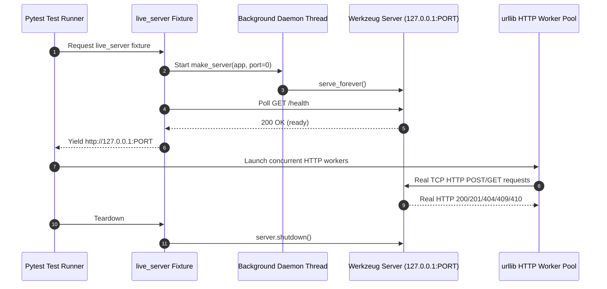

# Specification 004: Live Server Concurrency & Correctness E2E Tests

**Scope: Test Layer & Test Harness** (Live HTTP Server Fixture & Concurrency Verification Test Suite)

---

## 1. Overview & Scope

### 1.1 Purpose
This specification defines an end-to-end (E2E) concurrency test suite running against a **real live HTTP server** (listening on an ephemeral loopback socket `http://127.0.0.1:<port>`). The tests verify the correctness, thread safety, and invariance guarantees of the Flash Sale Inventory Reservation engine under heavy concurrent loads.

### 1.2 Declared Scope
- **In Scope**:
  - Live server fixture running Werkzeug HTTP server in a background daemon thread on a dynamic available port.
  - Zero-dependency HTTP test client helper using Python's standard `urllib.request`.
  - Configurable lease duration (`LEASE_DURATION_SECONDS`) to enable fast, crisp expiry testing without 30-second delays.
  - Concurrency test cases:
    1. Cross-item parallelism (zero cross-item contention).
    2. Same-item heavy contention with quota breaching attempts.
    3. Just-In-Time (JIT) lease reclamation under concurrency.
    4. *Suggested Test*: Payment confirmation vs. lease expiration race condition.
    5. *Suggested Test*: Concurrent reservation cancellation & immediate reallocation.
- **Out of Scope / No Changes to**: Core API routes or schemas (preserving existing contracts).

---

## 2. Live HTTP Server Test Fixture

### 2.1 Architecture
To test against a real running server making authentic socket-based HTTP requests:
1. **Dynamic Port Binding**: Bind to port `0` on `127.0.0.1` to let the OS assign an unused ephemeral port.
2. **Werkzeug Live Server**: Wrap `app` with `werkzeug.serving.make_server` and run in a daemon thread.
3. **Session Fixture (`live_server`)**:
   - Spawns server thread at start of test session.
   - Polls `GET http://127.0.0.1:{port}/health` until responsive.
   - Yields the base URL (`http://127.0.0.1:{port}`).
   - Automatically shuts down server on test teardown.

### 2.2 Configurable Lease Duration
To keep tests fast and prevent 30-second test hangs:
- Add `LEASE_DURATION_SECONDS: float = 30.0` on `InventoryManager` as a class/instance attribute configurable via environment variable or monkeypatch.
- Concurrency expiration tests set `LEASE_DURATION_SECONDS = 1.0` second, allowing crisp, sub-second TTL verification.

---

## 3. Test Cases Specification

### 3.1 Test 1: Cross-Item Parallelism (Zero Contention Across Items)
- **Objective**: Confirm that concurrent reservations on different items execute independently without cross-blocking or inventory cross-contamination.
- **Workflow**:
  - 20 concurrent threads simultaneously send reservation requests across distinct catalog items:
    - 5 threads reserve 1 unit of `item_vip_ticket` (total stock = 10)
    - 10 threads reserve 2 units of `item_ga_ticket` (total stock = 50)
    - 5 threads reserve 1 unit of `item_merch_hoodie` (total stock = 5)
  - All users are distinct seeded buyers (`buyer_0` &hellip; `buyer_19`).
- **Assertions**:
  - All 20 requests succeed with `201 Created`.
  - Stock consistency across each SKU:
    - `item_vip_ticket`: held = 5, available = 5
    - `item_ga_ticket`: held = 20, available = 30
    - `item_merch_hoodie`: held = 5, available = 0
  - Invariant holds: $\text{total\_stock} = \text{available\_stock} + \text{held\_stock} + \text{confirmed\_stock}$ for all items.

---

### 3.2 Test 2: High Contention on Same Item & Quota Breaching
- **Objective**: Under heavy concurrency on a single item, verify that stock is never oversold and per-user anti-hoarding quotas are strictly enforced.
- **Target Item**: `item_vip_ticket` (total stock = 10, max_per_user = 2).
- **Workflow**:
  - 30 concurrent requests race simultaneously:
    - **Group A (Valid demands)**: 10 distinct users attempt to reserve 2 units each (total demand = 20 units; capacity is only 10).
    - **Group B (Quota breaches)**: 5 users attempt to reserve 3 units each (exceeds `max_per_user = 2`).
    - **Group C (Duplicate user hoarding)**: 5 users make duplicate parallel requests for 2 units each.
- **Assertions**:
  - Exactly 5 requests from Group A succeed (`5 * 2 = 10` units held).
  - All remaining 25 requests fail with `409 Conflict` (either `Insufficient stock` or `Purchase limit exceeded`).
  - Zero overselling: `held_stock == 10`, `available_stock == 0`, `total_stock == 10`.

---

### 3.3 Test 3: Just-In-Time (JIT) Reclamation Under Concurrency
- **Objective**: Verify that expired reservations are reclaimed JIT and immediately made available to waiting concurrent buyers.
- **Workflow**:
  - Configure lease TTL = 1.0 second.
  - 5 threads reserve all 5 units of `item_merch_hoodie` (total stock = 5) &rarr; `available_stock` reaches 0.
  - An overflow request receives `409 Insufficient stock`.
  - Sleep 1.2 seconds (leases expire).
  - 5 new buyers concurrently race to reserve 1 unit each.
  - Concurrently, 5 reader threads query `GET /items/item_merch_hoodie` and `GET /items`.
- **Assertions**:
  - Reader queries trigger JIT reclamation; all overdue leases transition to `EXPIRED`.
  - New buyers successfully acquire the reclaimed inventory (5 succeed with `201 Created`).
  - Old buyers attempting late confirmation receive `410 Gone`.

---

### 3.4 Suggestion 4: Confirm vs. Lease Expiry Collision Race
- **Objective**: Stress-test the exact moment a lease reaches expiration while the owner attempts to confirm payment.
- **Workflow**:
  - Buyer reserves 1 unit (TTL = 1.0s).
  - At second 1.0, two threads execute simultaneously:
    - Thread 1: `POST /reservations/<id>/confirm`
    - Thread 2: A new buyer attempts `POST /reservations` for the same unit.
- **Assertions**:
  - Mutually exclusive outcomes under the item lock:
    - Either Thread 1 commits before expiry &rarr; `200 OK` (status `CONFIRMED`), and Thread 2 receives `409 Insufficient stock`.
    - Or lease expired &rarr; Thread 1 receives `410 Gone`, and Thread 2 acquires the released unit (`201 Created`).
  - Invariant strictly maintained: stock is never double-allocated.

---

### 3.5 Suggestion 5: Concurrent Cancellation & Immediate Reallocation
- **Objective**: Verify that when a user cancels an active reservation lease, the held stock is released atomically and immediately claimable by another waiting buyer.
- **Workflow**:
  - User reserves last unit of an item (`available_stock = 0`).
  - Simultaneously fire:
    - Thread 1: `POST /reservations/<id>/cancel`
    - Thread 2: New buyer `POST /reservations`
- **Assertions**:
  - Cancellation succeeds (`200 OK`).
  - New buyer successfully acquires the released unit (`201 Created`).
  - Final stock state is 100% consistent with no ghost holds.

---

## 4. Test File Structure

A dedicated test module:
[`tests/test_concurrency_live_server.py`](file:///Users/hammad/Projects/flask_ai_template/tests/test_concurrency_live_server.py)
- Keeps existing unit/contract tests separate and clean in `tests/test_api.py`.
- Encapsulates the live server fixture, HTTP client helper, and the 5 crisp concurrency tests.
